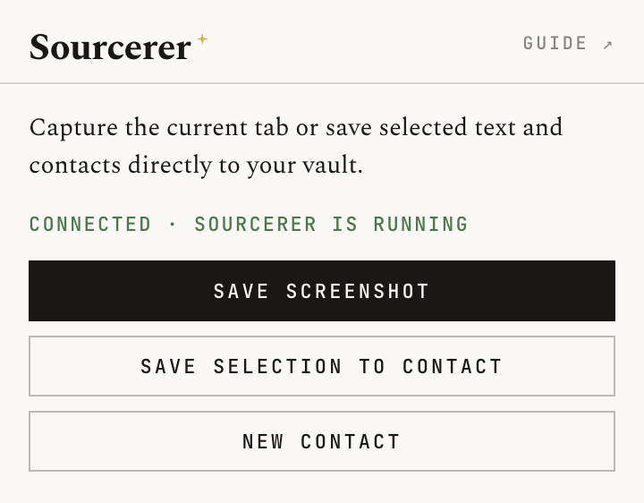

# Browser extension

Capture pages, save selected text, and add contacts — without leaving your browser.

## Installation

### Chrome, Edge, Brave, Arc

[Install from the Chrome Web Store](https://chromewebstore.google.com/detail/sourcerer/pipgdnekoknjbghnmhilapocpchdcadm)

### Firefox (109 or later)

[Install from Firefox Add-ons](https://addons.mozilla.org/en-CA/firefox/addon/sourcerer-for-journalists/)

## Connecting to the app

The extension communicates with the Sourcerer desktop app over a local HTTP server on `127.0.0.1:27371`. The app must be open and unlocked for any feature to work.

The first time you open the popup, click **Connect to Sourcerer**. An approval prompt will appear in the app — click **Approve**. This issues a session token to the extension. The token is stored in the browser's session storage and persists until you close the browser. The connection must be re-granted after the app is locked — either by the auto-lock timer or manually — so you may need to reconnect after a lock/unlock cycle.

If the app is locked, the popup will tell you. Unlock it first, then try again.

## Saving a screenshot

Navigate to any page, open the popup, and click **Save screenshot**. The extension captures the full page — scrolling through it automatically to stitch together sections taller than the viewport — and sends the result to the app.

Once received, a modal appears in the app asking you to assign the screenshot to a contact. Screenshots are stored encrypted alongside the database and are visible in the contact's detail panel.

Pages with very heavy fixed or sticky elements (sticky headers, cookie banners) are handled automatically — they are hidden during capture and restored afterward.

## Saving selected text to a contact

Select any text on a page — an email address, phone number, a note — then open the Sourcerer popup. If a selection is detected, a **Save selection to contact** button appears.

1. Click the button. The selected text is shown in a preview.
2. Choose what type of field to save it as: _Email_, _Phone_, or _Note_.
3. Search for the contact you want to attach it to and click their name.
4. Click **Save to contact**. The field is added immediately.

Notes are appended to the contact's existing notes with a blank line separator, so previous notes are never overwritten.

## Adding a new contact

Click **New contact** in the popup. Fill in the name (required), organisation, title/role, email, phone, and source URL, then click **Add contact**. The contact is created in your encrypted local database immediately.

The **Source URL** field pre-fills with the current tab's URL automatically. If you have [Wayback Machine archiving](guide.html#alerts) enabled and configured in Sourcerer, saving a website URL will submit it to the Internet Archive in the background — the snapshot URL is then saved to the contact record.

You can then open the app to add more details, link to a project, or take a screenshot.

## Right-click menu

You do not need to open the popup first. Select text on any page, right-click, and look for **Save to Sourcerer** in the context menu. Four sub-options are available:

- **Save as email** — adds the selection as an email address on a contact you choose.
- **Save as phone** — adds the selection as a phone number.
- **Save as note** — appends the selection to a contact's notes.
- **Add as new contact** — opens the new contact screen with the selected text pre-filled in the Name field.

On Chrome 127 and later the popup opens automatically after you choose an option. On older versions, click the extension icon to open it manually — the action will be queued and waiting.

## Security

The extension can only communicate with `127.0.0.1:27371`. All requests are authenticated with a session token issued by the app and stored only in the browser's session storage — it is cleared when the browser closes.

The local HTTP server only accepts requests that carry a valid `X-Sourcerer-Token` header and originate from a `chrome-extension://` or `moz-extension://` origin. Ordinary web pages cannot reach the server.

No data is sent to any external server. Screenshots, contacts, and fields go directly into the encrypted local database. The extension has no network permissions beyond `127.0.0.1:27371`.
